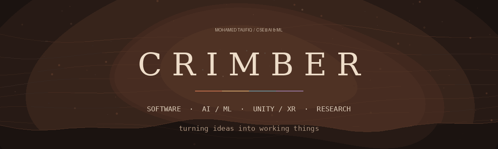

  

*Mohamed Taufiq · CSE (AI & ML) Undergraduate*

[GitHub](https://github.com/CRIMBER) · [LinkedIn](https://www.linkedin.com/)

---

## About

I'm a computer science undergraduate interested in the intersection of **technology, systems, and creativity**.

I enjoy building software, exploring artificial intelligence and machine learning, creating games and interactive experiences with Unity, and experimenting with ideas that push beyond the usual boundaries.

My interests don't fit into a single box, and I don't want them to. I like taking an idea, figuring out how it could work, and turning it into something tangible.

This profile is where I document that process — projects, experiments, discoveries, and everything I learn along the way.

## What I explore

<table>
<tr>
<td width="50%" valign="top">

### Software engineering

Applications, web projects, developer tools, and the systems that bring ideas to life.

</td>
<td width="50%" valign="top">

### AI & machine learning

Predictive models, intelligent applications, and experiments with data-driven systems.

</td>
</tr>
<tr>
<td width="50%" valign="top">

### Unity & XR

Games, interactive environments, immersive experiences, and digital worlds.

</td>
<td width="50%" valign="top">

### Research & experimentation

Technical concepts, unconventional ideas, system architecture, and prototypes.

</td>
</tr>
</table>

---

## Selected work

<table>
<tr>
<td width="33%" valign="top">

### STELLO

An experimental project exploring software and AI.

[**Explore repository ↗**](https://github.com/CRIMBER/stello)

</td>
<td width="33%" valign="top">

### Portfolo

A project focused on portfolio creation and presentation.

[**Explore repository ↗**](https://github.com/CRIMBER/portfolo)

</td>
<td width="33%" valign="top">

### DNS Security Platform

A project exploring DNS security and networking.

[**Explore repository ↗**](https://github.com/CRIMBER/DNS-SECURITY-PLATOFRM)

</td>
</tr>
</table>

[View all repositories →](https://github.com/CRIMBER?tab=repositories)

---

## Currently exploring

- Building practical software projects and strengthening engineering fundamentals
- Applying AI/ML concepts to real problems
- Continuing to create with Unity and game technologies
- Turning research ideas into experiments and prototypes

---

*Different disciplines. One creative mindset.*

 

 

*Still learning. Always making something.*

